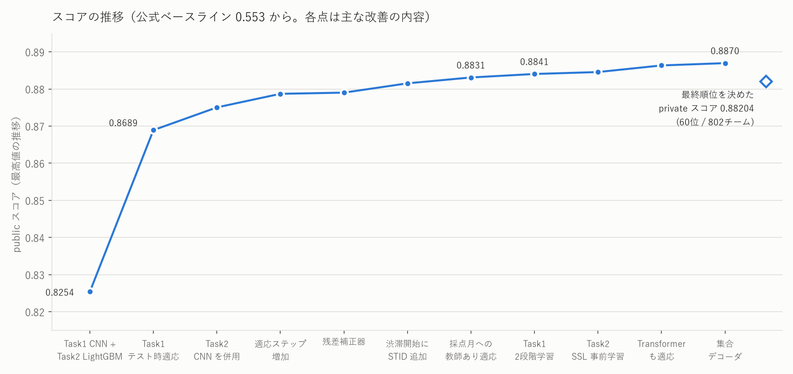

# Traffic Flow Bench — 2026 IEEE Big Data Cup（Kaggle）

**最終順位：60 位 / 802 チーム（上位 7.5%）・private スコア 0.88204・2 名チーム**

> **English summary.** Our solution to the Kaggle competition *2026 IEEE Big Data – Traffic Flow Bench*, finishing
> 60th of 802 teams (private 0.88204). The task is multi-objective freeway traffic analysis on simulated sensor data:
> imputing masked speed / flow, forecasting where queues form 30 minutes ahead, physical (conservation-law)
> consistency, and origin–destination flow estimation. The key difficulty was a distribution shift: the scored
> months come from different simulation runs than the training data. Our main contributions are (1) a two-stage
> self-supervised training that makes test-time adaptation work, (2) causal, label-free adaptation of the forecasters
> to each scored month using only data released before each forecast time, and (3) an evaluation protocol
> (cross-month selection, standard-error thresholds) that tracks the leaderboard. Over 170 experiment notes are in
> [`notes/`](notes/).

---

## 1. どんなコンペか

米カリフォルニアの高速道路 10 区間を模した交通シミュレーションのデータ（センサーごとの 5 分間隔の速度・交通量）
を使い、次の 4 つの課題をまとめて解くコンペです。

| 課題 | 内容 | スコアの重み |
|---|---|---|
| Task 1 状態推定 | 欠けているセンサー値（速度・交通量）を推定する | 0.35 |
| Task 2 渋滞予測 | 30 分後までに、どのリンクで渋滞が起きているかを予測する（新しく始まる渋滞と、続いている渋滞の 2 種類） | 0.30 |
| Task 3 物理整合性 | Task 1 の答えが、車の保存則（流入 − 流出 = 台数の変化）を満たしているかで採点される | 0.15 |
| Task 4 OD 推定 | 出発地と目的地の組ごとの交通量を推定する | 0.20 |

**最大の難しさ：** 採点に使われる 2 か月分のデータは、学習用データとは**別条件のシミュレーション実行**から
作られています。どこで渋滞が起きやすいかといった「学習データの癖」が、本番ではそのまま通用しません。

## 2. 結果

- 公式ベースライン（0.553）から始めて、public スコアの最高は 0.8870 になりました。
- 最終順位（private）は **60 位 / 802 チーム**、スコアは 0.88204 です。

## 3. アプローチ

### Task 1：欠損値の推定

- **モデル：** (時刻 × 地点) の格子を 1 枚の画像として扱う CNN（幅 192、残差ブロック 12 段）を、5 つのシードで
  学習して平均します。
- **2 段階学習：**
  1. 自分で作ったランダムな穴埋め問題（欠損率 10〜70%）で事前学習します。
  2. 本来の課題で学習します。
- **テスト時適応（TTT）：** 採点月の観測値の一部を隠して当てる自己教師ありの学習で、モデルをその月に合わせます。
  事前学習をしていないモデルでは、この適応がかえって物理整合性のスコアを下げていました。2 段階学習を入れて
  初めて、適応が効くようになりました。
- 再現用のコードと説明は [`share/task1_AS/`](share/task1_AS/) にあります。

### Task 2：渋滞予測

- **続いている渋滞：** 性質の違う複数のモデルを組み合わせます。
  - CNN、Transformer、LightGBM、STID（リンク・時刻の埋め込み + MLP）
  - これらの予測を合成したうえで、外れやすい箇所だけを補正するモデル（残差補正器）を重ねます。
- **新しく始まる渋滞：** 「候補のボトルネックのうち、どれが最初に詰まるか」という競争の問題として捉え直しました。
  候補の選び直しと、2 か所目を追加するかの判断を学習する「集合デコーダ」を作りました。
- **採点月への適応：** 各予測時点より前に公開されたデータだけを使って、その月の「疑似的な問題」を作ります。
  そこでモデルを日ごとに追加学習させます（未来の情報は一切使いません）。
- 再現用のコードと説明は [`share/task2_ongoing/`](share/task2_ongoing/)（続いている渋滞）にあります。

### Task 3・Task 4

- **Task 3：** Task 1 の精度がそのまま反映されるので、Task 1 を改善する方針で取り組みました。
- **Task 4：** 運営の参照解法（事前分布に寄せた非負最小二乗）を使っています。

## 4. 工夫した点・苦労した点

- **手元の評価が本番と食い違う問題：** 手元で良く見えた改善が、順位表では悪化することが続きました。原因を調べると、
  次の 2 つが分かりました。
  - 採点月が、学習とは別のシミュレーション実行から作られている。
  - 採点される時間帯が、月の最初の数日に偏っている。

  そこで評価条件を本番に合わせて作り直し、「片方の月で選んだ設定を、もう片方の月で確かめる」交差検証と、
  「改善幅が標準誤差を超えるか」という採用基準を設けました。
- **分布のずれへの対処：** 「採点月のデータで、公開済みの範囲だけを使って適応する」手法が、最も大きくスコアを
  伸ばしました。2 段階学習と組み合わせると、さらに効果が上がりました。
- **うまくいかなかったことの記録：** 外れた仮説も含めて、すべての実験を数値付きで [`notes/`](notes/) に残しました。
  そのうえで、次の方針を決めました。

## 5. リポジトリ構成

| パス | 内容 |
|---|---|
| [`scripts/`](scripts/) | 本番の予測パイプライン（学習済みモデルからの予測、提出ファイルの組み立て） |
| [`analysis/`](analysis/) | 各タスクのモデルの学習、データ分析、評価のスクリプト |
| [`tfb/`](tfb/) | 共通ライブラリ（データの読み込み、評価指標、物理スコア、提出ファイルの形式） |
| [`occ_lab/`](occ_lab/) | Task 2 の研究コード（追加モデル、残差補正器、集合デコーダ、学習済み LightGBM） |
| [`tta_lab/`](tta_lab/) | テスト時適応（TTT）の実験キット |
| `dcrnn_lab/`, `fm_lab/`, `gen_lab/`, `sim_lab/`, `tfm_lab/`, `mm_lab/`, `data_lab/` | 個別の実験（DCRNN、時系列基盤モデル、拡散モデル、交通シミュレータによるデータ生成など） |
| [`share/`](share/) | 再現用パッケージ（Task 1、Task 2 の続いている渋滞） |
| [`notes/`](notes/) | 実験ノート 170 本以上（問い・数値・結論を 1 本ずつ）。一覧は [`notes/README.md`](notes/README.md) |
| [`docs/reports/`](docs/reports/) | チーム内向けの報告書、手法調査、データ分析（EDA） |

## 6. 再現について

- コンペのデータは規約上ここには含めていません。Kaggle から取得し、`data/kaggle_public/` に置いてください。
- 運営のリポジトリ（`trafficflowbench-public/`）も別途必要です。
- 学習済みモデルの重みや予測結果はサイズが大きいため含めていません（`.gitignore` を参照）。
- 各タスクの手順は、`share/` 内の README と実行スクリプトに書いてあります。

## 7. チーム

2 名チームで参加しました。
